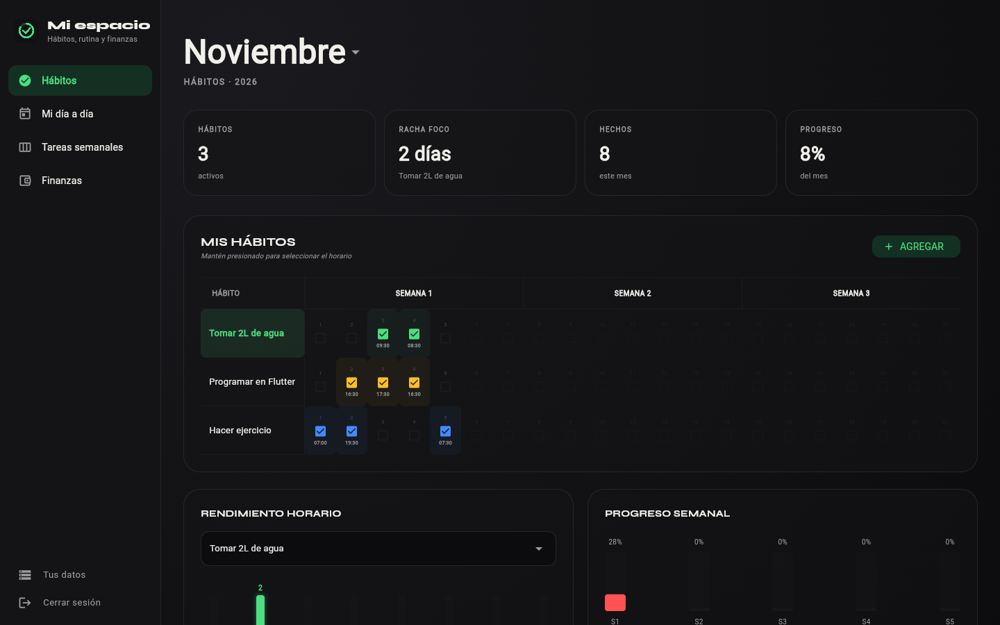
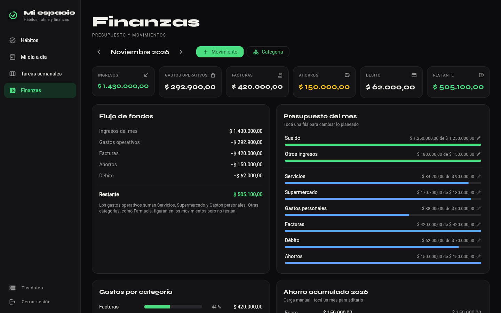
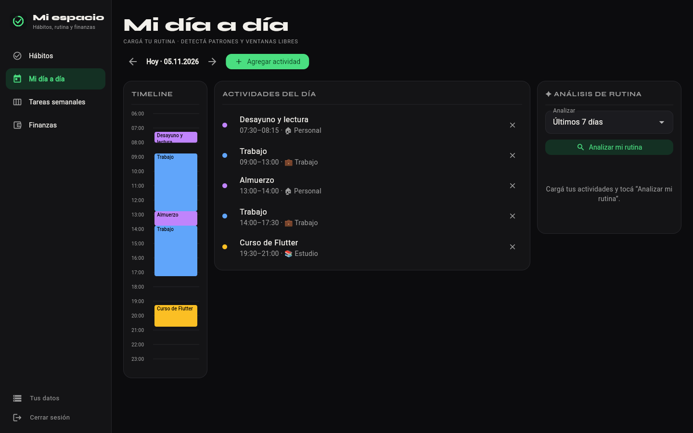
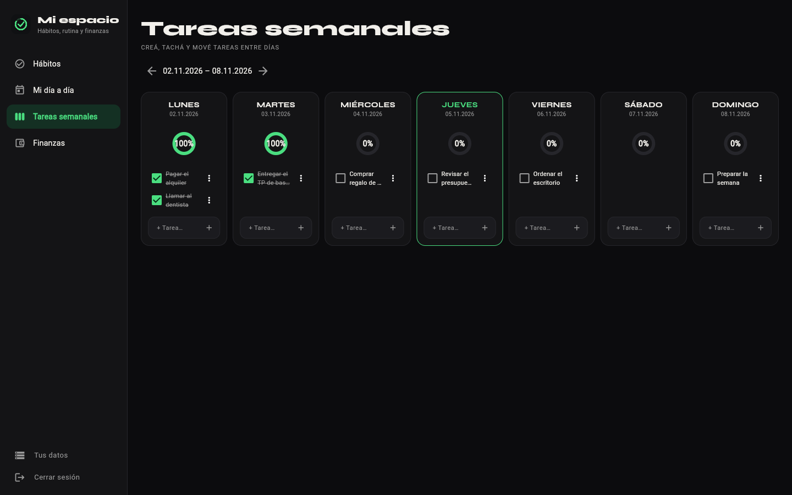
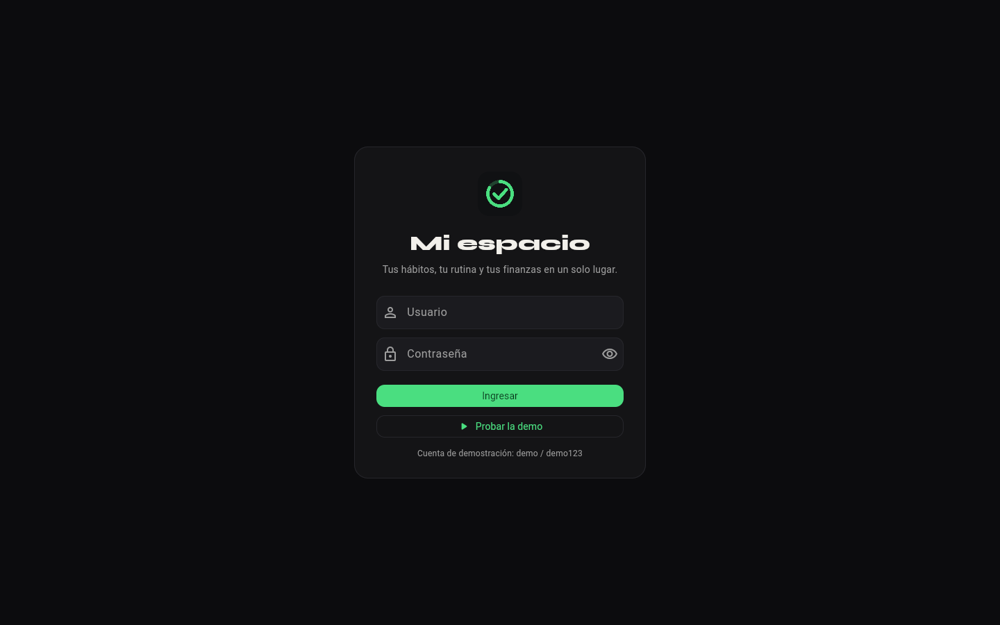
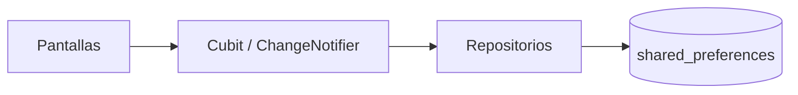

<div align="center">


# Mi espacio

**Hábitos, rutina diaria, tareas semanales y finanzas personales en una sola app Flutter.**


[](https://github.com/RenzoLeporace/habit-tracker-v4/actions/workflows/ci.yml)
[](https://github.com/RenzoLeporace/habit-tracker-v4/actions/workflows/pages.yml)

### [Probar la demo](https://renzoleporace.github.io/habit-tracker-v4/?demo)



</div>

> **In English:** A Flutter app (web, Android, iOS and desktop) that brings together habit tracking, a daily
> routine planner, weekly tasks and a personal budget. Dark UI with a single accent color, Spanish (Argentina)
> locale, local persistence with `shared_preferences`, demo data on first launch and 22 automated tests that
> run on GitHub Actions before every deploy to GitHub Pages.

## Índice

- [Capturas](#capturas)
- [Qué podés hacer](#qué-podés-hacer)
- [Demo](#demo)
- [Finanzas](#finanzas)
- [Arquitectura](#arquitectura)
- [Ejecutar en local](#ejecutar-en-local)
- [Pruebas](#pruebas)
- [Estructura del proyecto](#estructura-del-proyecto)

## Capturas

| Finanzas | Mi día a día |
| --- | --- |
|  |  |
| **Tareas semanales** | **Inicio de sesión** |
|  |  |

## Qué podés hacer

- **Hábitos:** registrar hábitos, marcarlos día a día con su horario y ver la racha, el progreso del mes, el
  rendimiento por franja horaria, el progreso semanal y un mapa del mes.
- **Mi día a día:** cargar actividades con horario y categoría en una línea de tiempo, recorrer los días y detectar
  bloques que se repiten y huecos libres de al menos 30 minutos. El análisis es local, sin servicios externos.
- **Tareas semanales:** crear, tachar, mover y borrar tareas en una semana de lunes a domingo; al moverlas a otro
  día vuelven a quedar pendientes.
- **Finanzas:** registrar, editar y borrar ingresos y gastos (con opción de deshacer), planificar el presupuesto
  por categoría, ver los gastos por categoría y llevar el ahorro acumulado del año.
- **Tus datos:** volver a cargar los datos de ejemplo o borrar todo y empezar de cero.

La interfaz se adapta a escritorio (menú lateral) y a celular (barra inferior), y usa formatos de Argentina:
`$ 1.234,50`, fechas `dd/mm/aaaa` y calendarios en español.

## Demo

La demo se publica en GitHub Pages con cada cambio en `main`, después de pasar el análisis y las pruebas.

- **[Entrar directo a la demo](https://renzoleporace.github.io/habit-tracker-v4/?demo)**, o abrir una sección
  puntual: [Mi día a día](https://renzoleporace.github.io/habit-tracker-v4/?demo&seccion=rutina),
  [Tareas](https://renzoleporace.github.io/habit-tracker-v4/?demo&seccion=tareas) o
  [Finanzas](https://renzoleporace.github.io/habit-tracker-v4/?demo&seccion=finanzas).
- Desde la pantalla de inicio de sesión, con el botón **Probar la demo** o con el usuario `demo` y la contraseña
  `demo123`.

La primera vez se cargan hábitos, actividades, tareas y movimientos de ejemplo. Todo se guarda en el navegador o
en el dispositivo.

> El acceso de demostración no protege datos: está implementado con `AuthRepository` y se reemplaza por un
> servicio de identidad real cambiando `DemoAuthRepository` en `lib/main.dart`.

## Finanzas

- El **ingreso del mes** suma todos los ingresos.
- Los **gastos operativos** incluyen Servicios, Supermercado y Gastos personales.
- Facturas, Ahorros y Débito se descuentan por separado.
- El **restante** es el ingreso menos esas cuatro salidas. Otras categorías, como Farmacia, aparecen en los
  movimientos y en los gastos por categoría, pero no afectan el restante.
- Lo planeado por categoría y el ahorro de cada mes se cargan a mano tocando la fila.

## Arquitectura



| Pieza | Responsabilidad |
| --- | --- |
| `HabitCubit` | Estado de los hábitos con `flutter_bloc`; las rachas se calculan en casos de uso de dominio |
| `RoutineController`, `FinanceController` | Estado de rutina, tareas y finanzas con `ChangeNotifier` |
| `RoutineRepository`, `FinanceRepository` | Interfaces de datos con adaptadores locales; se pueden reemplazar por una base de datos sin tocar las pantallas |
| `DemoData` | Datos de ejemplo de la primera vez y opciones para restaurarlos o borrar todo |
| `AppTheme`, `AppColors` | Tema oscuro con un único acento verde |

## Ejecutar en local

Necesitás Flutter 3.41 (Dart 3.11). Desde la raíz del repositorio:

```sh
flutter pub get
flutter run -d chrome
```

También corre en Android, iOS, Windows, macOS y Linux con `flutter run`. En Windows, los plugins de Flutter
requieren activar el modo de desarrollador para crear enlaces simbólicos.

## Pruebas

```sh
flutter analyze
flutter test
```

Las **22 pruebas** cubren las reglas de finanzas, el formato de importes y fechas, los datos de ejemplo, la carga
simultánea de datos sin duplicados, las categorías propias, deshacer un borrado, el análisis de rutina, las tareas
semanales y el diseño en celular y escritorio. GitHub Actions corre formato, análisis y pruebas en cada cambio y
antes de publicar la demo.

## Estructura del proyecto

```text
lib/
├── core/
│   ├── demo_data.dart      # datos de ejemplo y reinicio
│   ├── format.dart         # importes, fechas y porcentajes en es-AR
│   └── theme/              # colores y tema
├── features/
│   ├── habits/             # datos, dominio (rachas) y presentación con Cubit
│   ├── routine/            # rutina diaria y tareas semanales
│   └── finance/            # presupuesto y movimientos
└── main.dart               # app, inicio de sesión y navegación
test/                       # pruebas de lógica y de interfaz
docs/capturas/              # capturas del README
```
